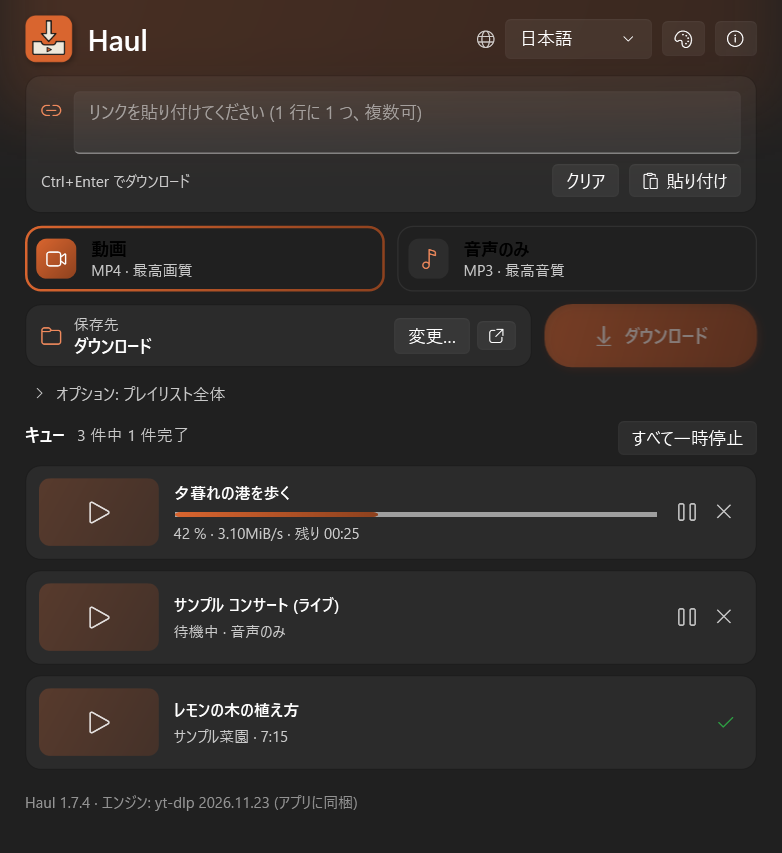
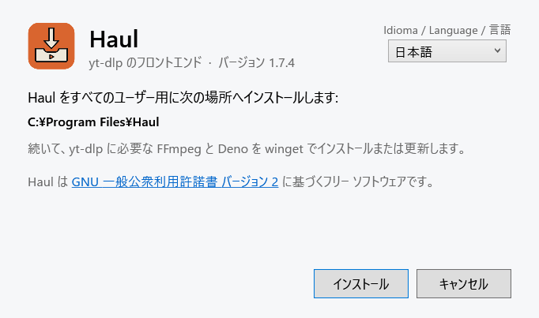
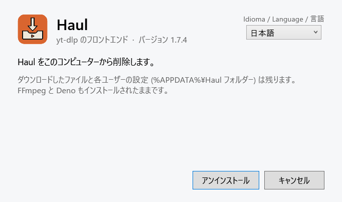
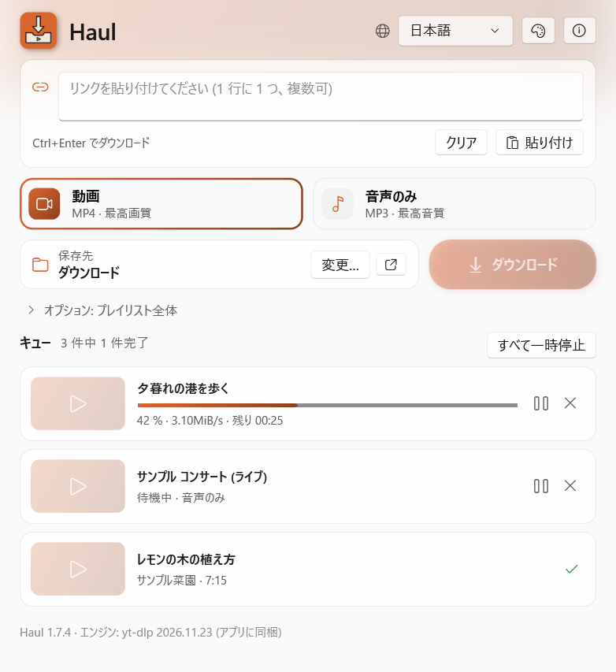
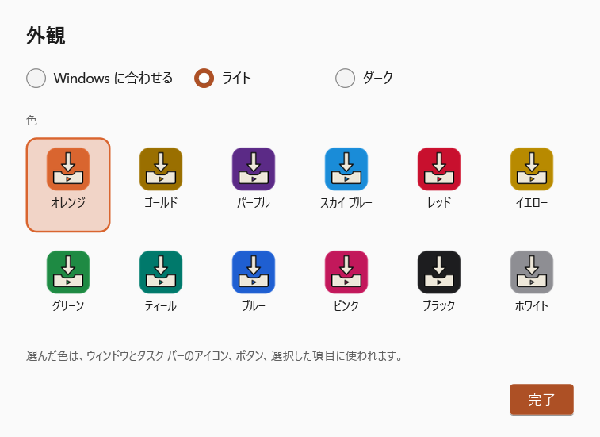
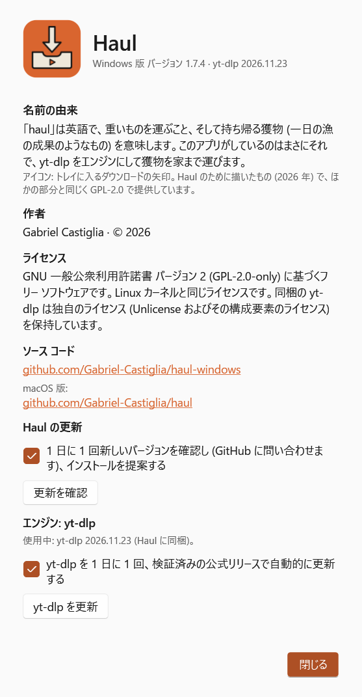
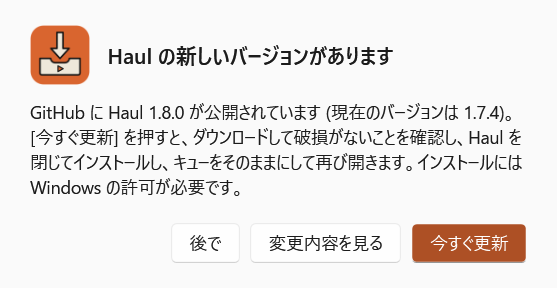

<p align="center"></p>

<h1 align="center">Haul for Windows</h1>
<p align="center"><b>Web の動画や音楽を、yt-dlp の力でフォルダーへ。</b></p>

<p align="center"></p>

Gabriel Castiglia · 2026 年 11 月 27 日 · バージョン 1.8.0 · GPL-2.0-only · yt-dlp 2026.11.23 でビルド・テスト済み

[English](README.md) · [Español](README.es.md) · 日本語

macOS 版: <https://github.com/Gabriel-Castiglia/haul>（Apple シリコン専用）

> **Windows 10/11 の x64（64 ビットの Intel または AMD）専用です。** ARM プロセッサ用のビルドはありません。

PDF マニュアル: [`docs/Haul-manual-ja.pdf`](docs/Haul-manual-ja.pdf)

Haul は [yt-dlp](https://github.com/yt-dlp/yt-dlp) のフロントエンドとして動く Windows アプリです。アプリはコマンドを組み立て、進行状況を表示し、ダウンロードのキューを管理します。実際の処理は、検証済みの固定バージョンでアプリに同梱された yt-dlp と、ffmpeg が行います。同じ名前の macOS アプリの Windows 版で、機能も形式も動作も同じです。ウィンドウはライト、ダーク、または Windows に合わせることができ、12 色から色を選べます。画面は日本語、英語、スペイン語で表示できます。最初はセットアップ ウィンドウで選んだ言語で開き、セットアップを使わなかった場合は、Windows が日本語かスペイン語ならその言語（それ以外は英語）で開きます。選んだ言語は次回も保たれます。Haul は自分自身も yt-dlp も最新の状態に保ちます。

## 動作環境

- Windows 11、または Windows 10 バージョン 1809 以降。x64 の PC（64 ビットの Intel または AMD）。Windows 11 Pro でテストしています。
- [winget](https://learn.microsoft.com/windows/package-manager/winget/)（Microsoft Store の「アプリ インストーラー」。Windows 11 には最初から入っています）。セットアップが FFmpeg と Deno のインストールに使います。
- インターネット接続（ダウンロードと更新の確認に使います）。

yt-dlp はアプリに同梱され、Haul は自分の .NET ランタイムを内蔵しているので、手作業でインストールするものはありません。

## インストール

[最新リリース](https://github.com/Gabriel-Castiglia/haul-windows/releases/latest)から `haul-setup.exe` をダウンロードして実行します。セットアップ ウィンドウは、インストール済みの Haul の言語、日本語またはスペイン語の Windows ではその言語、それ以外では英語で開きます。右上の言語メニュー（「Idioma / Language / 言語」）で選ぶと、すべてのページの言語がすぐに切り替わります。Haul はすべてのユーザー向けに `C:\Program Files\Haul` にインストールされるため管理者権限が必要です（インストール開始時に Windows が確認します）。スタート メニューにも追加されます。続いて、セットアップを実行したユーザーとして winget で FFmpeg と Deno をインストールします（すでにあれば更新します）。yt-dlp は、映像と音声の結合と MP3 への変換に FFmpeg を、JavaScript のチャレンジを解くのに Deno を使います。セットアップ ウィンドウで選んだ言語が、Haul を初めて起動したときの言語になります。



| ファイル | 内容 |
|---|---|
| `haul-setup.exe` | セットアップ プログラム（日本語、英語、スペイン語）。通常はこれでインストールします。 |
| `haul.msi` | 同じインストールの Windows インストーラー パッケージ。サイレント インストール用: `msiexec /i haul.msi /qn`。FFmpeg と Deno はインストールしないので、`winget install yt-dlp.FFmpeg DenoLand.Deno` で入れてください。 |

新しい `haul-setup.exe` を実行すると、インストール済みの Haul が更新され、各ユーザーの設定はそのまま残ります。Haul が実行中なら、セットアップがファイルを置き換える前に終了させます。バージョン 1.4 以前のスクリプトで作られたインストール（`%LOCALAPPDATA%\Programs\Haul`）は、設定を残したまま削除され、Haul は 1 つだけになります。新しいバージョンの上に古いバージョンをインストールすることはできません。Haul は自分で更新することもできます。[更新](#更新)を参照してください。

ファイルには商用の証明書による署名がないため、初回は Windows SmartScreen が「Windows によって PC が保護されました」と表示することがあります。「詳細情報」→「実行」で起動できます。各リリースの `SHA256SUMS.txt` で、ダウンロードしたファイルを先に確認できます（PowerShell で `Get-FileHash haul-setup.exe`）。

## アンインストール

設定 → アプリ → インストールされているアプリ を開き、Haul を探して「アンインストール」を選びます。言語メニュー付きの同じセットアップ ウィンドウが開き、「Haul をこのコンピューターから削除します。」と表示されます。[アンインストール] を押すと、Haul が実行中なら終了させ、プログラムとスタート メニューのショートカットを削除します。ダウンロードしたファイル、各ユーザーの設定と保存されたキュー（`%APPDATA%\Haul`）、Haul がダウンロードした yt-dlp（`%LOCALAPPDATA%\Haul`）は残ります。この 2 つのフォルダーを削除すれば消えます。FFmpeg と Deno はほかのプログラムが使っている可能性があるため残ります。削除するには `winget uninstall yt-dlp.FFmpeg DenoLand.Deno` を実行します。



## 使い方

1. 上部の入力欄に 1 つ以上のリンクを貼り付けるか、[貼り付け] を押します。リンクは単独でも、1 行に 1 つずつでも、ほかの場所からコピーした文章の中にあってもかまいません。アプリがリンクを取り出し、重複を除きます。入力欄が空の状態でアプリを開くか前面に出すと、クリップボードのリンクを自動で取り込みます。
2. 形式を選びます。[動画]（MP4）または [音声のみ]（MP3）です。
3. [変更…] で保存先フォルダーを選びます。最初は「ダウンロード」フォルダーで、以後は最後に選んだフォルダーと形式が保存されます。
4. [ダウンロード] を押すか、Ctrl+Enter を押します。ダウンロードが始まると入力欄は空になり、すでにキューにあるリンクがクリップボードから再び取り込まれることはありません。

ターミナルやショートカットから、リンクを指定して起動することもできます。

```
"C:\Program Files\Haul\Haul.exe" --descargar URL1 URL2
```

## メイン ウィンドウ



| 部分 | 役割 |
|---|---|
| 言語メニュー（地球のアイコン） | 画面の言語を「日本語」、「English」、「Español」ですぐに切り替えます。選択は保存されます。 |
| パレットのボタン（「外観と色」） | 外観のウィンドウを開きます。ライト、ダーク、Windows に合わせる、と色を選べます（[ウィンドウとテーマ](#ウィンドウとテーマ)を参照）。 |
| ⓘ ボタン（「Haul について」） | バージョン、名前の由来、作者、ライセンス、ソース コード、更新の設定を表示します（[更新](#更新)を参照）。 |
| リンクの入力欄 | リンクを受け取ります。空のときは「リンクを貼り付けてください (1 行に 1 つ、複数可)」と表示されます。下の行にリンクの数（「リンク 2 件 · Ctrl+Enter でダウンロード」）、またはリンクがないとき「リンクが見つかりません」が表示されます。[クリア] で入力欄を空にし、[貼り付け] でクリップボードの内容を貼り付けます。 |
| [動画] / [音声のみ] | 形式です。「MP4 · 最高画質」または「MP3 · 最高音質」です（[形式](#形式)を参照）。 |
| 保存先 | 保存先フォルダーです。[変更…] で別のフォルダーを選び、その横のボタン（「エクスプローラーでフォルダーを開く」）でエクスプローラーに開きます。 |
| [ダウンロード] | ダウンロードを始めます。リンクが複数あると「3 件をダウンロード」、キューの実行中は「キューに追加」と表示されます。 |
| オプション | 3 つのオプションです。最初は折りたたまれています（[オプション](#オプション)を参照）。 |
| キュー | ダウンロードが 1 行に 1 つずつ並びます。概要（「5 件中 2 件完了 · 1 件エラー · 1 件一時停止中」）と、[すべてキャンセル]、[すべて一時停止]、[すべて再開]、[すべて再試行] のボタンが、必要なときに表示されます。 |
| 下端の行 | Haul と yt-dlp のバージョン（「(アプリに同梱)」または「(Haul が更新)」）と、更新の進行状況を表示します。 |

yt-dlp、ffmpeg、Deno のどれかが見つからないときは、キューの上にどれが足りないかが表示されます（「ffmpeg が見つかりません。haul-setup.exe をもう一度実行してください。winget で FFmpeg と Deno をインストールします。」）。

ヘッダーからオプションまでは固定され、スクロールするのはキューだけです。リンクを追加してもウィンドウの表示位置は動きません。

## キュー

リンクはキューに入り、1 つずつダウンロードされます。キューの実行中もリンクを追加できます。各行にはサムネイル、タイトル、進捗率、速度、残り時間と、処理の内容（「準備しています…」、「映像と音声を結合しています…」、「MP3 に変換しています…」）が表示されます。完了した行にはチャンネルと再生時間が表示され、ファイルをエクスプローラーで表示するボタン（「エクスプローラーで表示」）と、ファイルを開くボタン（「開く」）が付きます。各行には、その状態で使えるボタンがツールヒント付きで表示されます。「一時停止」、「再開」、「このダウンロードをキャンセル」、「再試行」、「キューから削除」です。キャンセルしたダウンロードは、自分が作った途中のファイルを削除します。フォルダーに前からあったファイル（同じ動画を別の形式で以前ダウンロードしたものなど）には一切触れません。

どの行も一時停止ボタンで止め、再生ボタンで続けられます。その間、途中のファイルはディスクに残るので、止まったところから再開します。キューの上の [すべて一時停止] はキュー全体を止めます。実行中のダウンロードは停止し、[すべて再開] を押すまで先頭で待ちます。[すべてキャンセル] は完了していないものをすべてキャンセルします。[すべて再試行] は失敗したダウンロードがあるときに表示され、失敗したものをすべてやり直します。ダウンロードはリストの順に始まります。順番は、行をマウスでドラッグするか、キーボードで変えられます。Tab キーで各行とそのボタンに移動し、Alt + ↑ キーまたは Alt + ↓ キーで行を 1 つ移動します。行のメニュー（右クリック、Shift + F10 キー、またはアプリケーション キー）にも同じ操作、[上へ移動] と [下へ移動] があります。

失敗したダウンロードは 2 秒おきに最大 4 回まで再試行され、何回目かが行に表示されます（「再試行 2/4」）。途中のファイルは試行の間も残るので、yt-dlp は止まったところから続けます。すべて失敗すると、yt-dlp が終了した時点で行が赤くなり、理由が表示されます（[トラブルシューティング](#トラブルシューティング)を参照）。それまではキャンセルだけができます。ダウンロードが終わると、yt-dlp が自分で削除できなかった中間ファイル（ファイル同期ソフトが開いていた MP3 の元の音声など）もアプリが削除します。

キューは Haul を閉じても残ります。待機中、一時停止中、失敗した行と、まだ追加されていなかったリンクは、次に開いたときに同じ順番で戻ります。閉じたときに実行中だったダウンロードは待機中に戻り、途中のファイルから続きます。読み込み中だったプレイリストは読み直されます。完了した行とキャンセルした行は残りません。キューは `%APPDATA%\Haul\queue.json` に保存されます。常に一時ファイルに書いてから古いファイルと置き換えるので、異常終了しても中途半端なファイルは残りません。壊れたファイルは `queue.damaged.json` として退避され、Haul は空のキューで起動します。

## オプション

「プレイリスト全体をダウンロード」、「インストゥルメンタルもダウンロード」、「完了したダウンロードを自動的に消去」は、[ダウンロード] ボタンの下の「オプション」にあります。キューの場所を空けるためこの行は最初は折りたたまれていて、オンのオプションが表示されます（「オプション: プレイリスト全体」）。クリックすると開き、開いたままにしたかどうかを Haul は覚えています。各オプションには説明のツールヒントがあり、設定は保存されます。

| オプション | オンのとき | オフのとき |
|---|---|---|
| プレイリスト全体をダウンロード（既定でオン） | プレイリストから開いた動画のリンクで、プレイリスト全体を取り込みます。 | 毎回カードで確認します（[プレイリスト](#プレイリスト)を参照）。 |
| インストゥルメンタルもダウンロード | タイトルに「instrumental」を含む動画も、ほかと同じくダウンロードします。 | キューの中で一時停止して待ちます（「一時停止中: インストゥルメンタルです」）。 |
| 完了したダウンロードを自動的に消去 | 完了またはキャンセルしたダウンロードが自動で一覧から消え、概要の数には含まれ続けます。失敗したものは再試行できるよう残ります。オンにすると、すでに完了していたものも消えます。 | 完了した行は削除するまで残ります。 |

一時停止中のインストゥルメンタルは、その行のダウンロード ボタン（「それでもダウンロード」）で個別にダウンロードできます。「インストゥルメンタルもダウンロード」をオンにすると、すべて再開します。

## プレイリスト

プレイリストのリンクやチャンネルのページは、まず何もダウンロードせずに読み込まれ（「プレイリストを読み込んでいます…」）、動画ごとにサムネイルと位置（「Mix · 3/12」）付きのキューの行になります。ファイルはプレイリスト名のサブフォルダーに保存され、プレイリストの順に番号が付きます（`01 - タイトル.mp4`、`02 - タイトル.mp4` など）。動画ごとにキャンセルや再試行ができます。200 本を超えるプレイリストは、先に確認します（「大きなプレイリスト」: [250 件を追加] または [キャンセル]）。

プレイリストから開いた動画のリンクは、「プレイリスト全体をダウンロード」がオン（既定）の間はプレイリスト全体を取り込みます。オフにすると、ウィンドウ内のカードが毎回確認します（「この動画はプレイリストに含まれています」）。選択肢は [プレイリスト全体]、[この動画のみ]、[キャンセル] です。ほかのリンクは、そのまま 1 本ずつダウンロードされます。

複数の投稿をまとめたタグのページ（各投稿に動画が埋め込まれているもの）も同じように読み込まれます。投稿ごとに 1 行、古いものから新しいものの順になるので、シリーズはエピソードの順を保ちます。

## 形式

| 形式 | 結果 | yt-dlp のオプション |
|---|---|---|
| 動画 | H.264 と AAC の MP4。H.264 で得られる最高の解像度 | `-f bv*+ba/b -S vcodec:h264,res,acodec:aac --merge-output-format mp4` |
| 音声のみ | 最高音質の MP3 | `-x --audio-format mp3 --audio-quality 0` |

H.264 を優先するのは、Windows のどのプレーヤーでも再生できるからです。ファイル名には動画のタイトルが使われます。画質を選ぶメニューはなく、Haul は常にその形式でサイトが提供する最高のものを求めます。

## ウィンドウとテーマ

ウィンドウはコンパクトで、Windows の拡大率が 125 % や 150 % の 1366 × 768 や 1280 × 720 の画面でも、キューに数行分の場所が残ります。保存先フォルダーと [ダウンロード] ボタンが 1 行に並び、オプションは折りたためます。560 × 420 より小さくはできません。キューに 2 行分の場所も残らないほどウィンドウの高さが低いときは、キューを押しつぶす代わりに上の部分がキューと一緒にスクロールし、ウィンドウを大きくすると元の固定位置に戻ります。サイズと位置は次回も保たれます。

アプリは Windows 11 の Fluent テーマを使い、「ライト」、「ダーク」、「Windows に合わせる」を選べます。「Windows に合わせる」は 設定 > 個人用設定 > 色 のアプリのモードに従い、アプリを開いている間の変更にも追従します。ヘッダーのパレットのボタンで開く外観のウィンドウ（「外観」）には 12 色もあります。「オレンジ」（既定）、「ゴールド」、「パープル」、「スカイ ブルー」、「レッド」、「イエロー」、「グリーン」、「ティール」、「ブルー」、「ピンク」、「ブラック」、「ホワイト」です。選んだ色はボタン、チェック ボックス、選択項目と、ウィンドウおよびタスク バーのボタンのアイコンに使われ、矢印とトレイがその色のタイルの上に描かれます。Haul はすべてのユーザー向けにインストールされ、スタート メニューのショートカットは全員のものなので、そのアイコンはオレンジのままです。色のタイルには Tab キーで移動し、Enter キーまたは Space キーで選ぶこともでき、スクリーン リーダーは色の名前を読み上げます。以前のバージョンの設定ファイルはそれまでのダークのウィンドウを保ち、新しいインストールは Windows に合わせます。



## 更新

ⓘ ボタンで開く「Haul について」のウィンドウに、Haul と yt-dlp の更新の設定があります。



**Haul。** 1 日に 1 回（「1 日に 1 回新しいバージョンを確認し (GitHub に問い合わせます)、インストールを提案する」がオンの間。既定でオン）と、[更新を確認] を押したとき、Haul は GitHub に最新リリースを問い合わせます。新しければ小さなウィンドウ（「Haul の新しいバージョンがあります」）で一度だけ尋ねます。選択肢は [今すぐ更新]、[変更内容を見る]（リリースのページを開きます）、[後で] です。確認、ダウンロード、キューの完了待ちのどれかが進行中に [更新を確認] を押すと、そのことを知らせ（「Haul の更新はすでに進行中です。」）、進行状況は下端の行に表示されます。



[今すぐ更新] を選ぶと、あとはすべて自動です。Haul はまず、リリースの `SHA256SUMS.txt` に作者の署名があることを確認します（`release.sig`。Haul に組み込まれた 2 つの鍵で検証します。有効な署名のないリリースは拒否され、そのページから手動でダウンロードするしかありません）。次に `haul-setup.exe` をダウンロードして、その `SHA256SUMS.txt` と照合します。一致しないファイルは削除され、実行されることはありません。実行の直前にもう一度照合し、Haul が閉じるまでファイルを開いたままにするので、その間にほかのプログラムが変更、置き換え、削除することはできません。ダウンロードの実行中なら、先に確認します（「キューにダウンロードが残っています」）。選択肢は [今すぐ更新]（ダウンロードは停止し、Haul が戻ったときに途中のファイルから続きます）、[キューの完了後]、[キャンセル] です。そのあとキューを保存して終了し、インストール時に選んだ言語のままセットアップ プログラムをサイレントで実行します。Haul はすべてのユーザー向けにインストールされているため、Windows が許可を求めます。セットアップ プログラムは Haul の終了を待ってからインストールし、キューごと Haul をもう一度開きます。インストールが行われなかった場合（許可を拒否したときなど）は、開いた Haul がそれを知らせます。GitHub への問い合わせには、プログラム名とバージョン以外は何も含まれません。

サイレント更新はセットアップ プログラム自身の機能です。`haul-setup.exe /quiet /norestart /HAULWAITPID=<pid> /HAULRELAUNCH=1` はそのプロセスの終了を待ち、最後に Haul を開きます。FFmpeg と Deno には触れません。`haul-setup.exe` を手動で実行すると、それらも更新されます。

**yt-dlp。** サイトは頻繁に変わるので、Haul はインストール時より新しい yt-dlp を取得することもできます。1 日に 1 回（「yt-dlp を 1 日に 1 回、検証済みの公式リリースで自動的に更新する」がオンの間。既定でオン）と、[yt-dlp を更新] を押したとき、Haul は GitHub に yt-dlp の最新の公式リリースを問い合わせます。新しいものは `%LOCALAPPDATA%\Haul\yt-dlp\<バージョン>\` にダウンロードされ、リリースの `SHA2-256SUMS` と照合され、一度実行してバージョン番号を確認します。そのうえで初めて Haul はそれを使い始め、ウィンドウ下端の行に「(Haul が更新)」と表示されます。実行中のダウンロードは始めたときのコピーで最後まで進み、次のダウンロードから新しいコピーを使います。Haul と一緒にインストールされたコピーは決して変更されず、検証済みのより新しいコピーがなければ再び使われます。ダウンロードした古いコピーは Haul の起動時に削除されます。どのコピーを使っているかは、「Haul について」の「エンジン: yt-dlp」の欄に表示されます。

## トラブルシューティング

yt-dlp のよくあるエラーは、画面の言語でわかりやすい言葉で表示されます。それ以外は yt-dlp が出力したとおりに表示されます。

| メッセージまたは症状 | 意味と対処 |
|---|---|
| 「この動画ではその形式を利用できません。」 | 多くの場合、サイトが変わってこの yt-dlp では読めなくなっています。ⓘ ウィンドウで [yt-dlp を更新] を押してから、行の [再試行] を押してください。 |
| 「サイトがロボットでないことの確認を求めています。Haul の最新バージョンをインストールしてください。」 | yt-dlp と Haul（[更新を確認]）を更新してください。 |
| 「この動画は利用できません (削除済み、非公開、またはブロックされています)。」 · 「非公開の動画です。」 | サイトがアクセス権のない人に動画を提供していないため、Haul ではダウンロードできません。 |
| 「アカウントでの年齢確認が必要なため、ダウンロードできません。」 | Haul はサイトにサインインしないので、これらの動画はダウンロードできません。 |
| 「このサイトは yt-dlp に対応していません。」 · 「有効なリンクではないようです。」 | リンクを確認してください。yt-dlp はそのサイトに対応していません。 |
| 「ページを開けませんでした。接続を確認してください。」 | 接続がないか、サイトが応答しませんでした。後で [再試行] を押してください。 |
| 「このチャンネルにはダウンロードできる動画がありません。」 · 「プレイリストが存在しないか、非公開です。」 | チャンネルやプレイリストに、公開されたダウンロード対象がありません。 |
| 「ffmpeg が見つかりません。haul-setup.exe をもう一度実行してください。winget で FFmpeg と Deno をインストールします。」 | `haul-setup.exe` をもう一度実行するか、`winget install yt-dlp.FFmpeg DenoLand.Deno` を実行してください。ffmpeg がないと、映像と音声の結合も MP3 の作成もできません。 |
| 「yt-dlp を起動できませんでした: …」 · 「yt-dlp がコード … で終了しました。」 | プログラムのファイルが壊れているか、ウイルス対策ソフトなどにブロックされています。`haul-setup.exe` をもう一度実行してください。 |
| 「保存されていたキューが壊れていたため、queue.damaged.json として別に保存しました」 | Haul は空のキューで起動しました。古いファイルは確認用に `%APPDATA%\Haul` に残ります。 |
| 「Haul … はインストールされませんでした (Windows の許可が得られなかった可能性があります)。」 | 更新はインストールされていません。ⓘ › [更新を確認] からもう一度試し、Windows の確認を許可してください。 |
| 「このリリースの署名が有効ではないため、何もダウンロードもインストールもしていません。」 | リリースに作者の有効な署名がないため、Haul は拒否しました。信頼できる場合に限り、そのページから手動でダウンロードしてください。 |
| 「yt-dlp を更新できませんでした: …」 | 以前の yt-dlp がそのまま使われます。後でもう一度試してください。 |
| 「Haul の更新はすでに進行中です。進行状況はウィンドウの下部に表示されます。」 | 更新の途中で [更新を確認] が押されました。終わるまで待ってください。 |
| セットアップの実行時に「Windows によって PC が保護されました」 | セットアップには商用の証明書による署名がありません。「詳細情報」→「実行」で起動できます。 |

設定（言語、フォルダー、形式、ウィンドウのサイズと位置、外観、色、オプションとその折りたたみ状態、更新の設定）は `%APPDATA%\Haul\settings.json` に、キューは `%APPDATA%\Haul\queue.json` に保存されます。Haul を閉じた状態で `settings.json` を削除すると、設定は初期状態に戻ります。

## 責任ある利用

Haul がダウンロードするのは、サイトがすでに誰にでも視聴を許しているものだけで、それも yt-dlp を通してのみです。ダウンロードは著作権法や各サイトの利用規約によって制限されている場合があります。Haul は、保存する権利のあるコンテンツ（自分のもの、自由なライセンスやパブリック ドメインのもの、権利者が許可しているもの）にだけ使い、お住まいの国の法律に従ってください。Haul と yt-dlp は DRM で保護されたコンテンツを復号しません。Haul は無保証で提供されます（[ライセンス](#ライセンス)を参照）。

## メンテナンス

Haul は yt-dlp 2026.11.23 でビルド・テストされ、そのコピーがそのまま同梱されています。バージョンを固定することで動作が安定し、yt-dlp のリポジトリが公開され続けることにも依存しません。その代わり、サイトは頻繁に変わるため、固定したバージョンはいずれサイトで動かなくなります。Haul のリリースの合間は、アプリからの yt-dlp の更新がそれを補います（[更新](#更新)を参照）。Haul の新しいリリースでは、同梱のコピーを新しい yt-dlp に移します。

```
powershell -ExecutionPolicy Bypass -File scripts\actualizar-yt-dlp.ps1 <バージョン>
powershell -ExecutionPolicy Bypass -File scripts\build.ps1
```

最初のスクリプトはリリースをダウンロードし、`vendor\yt-dlp\public.key` に保存された鍵で署名を（Git for Windows に付属する gpg を使って）、さらに SHA-256 チェックサムを検証してから、ファイルを置き換えてライセンス文を更新します。`yt-dlp.exe` に格納されたライセンスを読むために Python が必要です。新しい `haul-setup.exe` を実行すると、FFmpeg と Deno も更新されます。

## リポジトリの構成

| パス | 内容 |
|---|---|
| `fuentes/Haul/` | アプリのソースコード（C#、.NET 10 上の WPF） |
| `fuentes/Haul/Core/` | キューとその保存、プレイリスト、リンク、設定、更新、yt-dlp のプロセス、日本語・英語・スペイン語の画面の文字列（`Textos.cs`） |
| `assets/icon.svg` | アイコンの原画（12 色版は作者のアイコンツールで作成。macOS 版と共通） |
| `icono/Haul.ico`、`icono/icono-256.png`、`icono/icono-1024.png`、`icono/accents/` | 既定のオレンジと各色のアイコン |
| `installer/Msi/` | MSI パッケージ（WiX） |
| `installer/SetupUI/` | 日本語・英語・スペイン語のセットアップ ウィンドウ（.NET Framework 4.7.2、WPF。文字列は `SetupTexts.cs`）。winget の実行も担当 |
| `installer/Setup/` | セットアップ ウィンドウと MSI を収めたセットアップ プログラム（WiX バンドル） |
| `scripts/build.ps1` | 同梱の yt-dlp を確認し、Haul、`haul.msi`、`haul-setup.exe` を `dist\` に作成 |
| `scripts/actualizar-yt-dlp.ps1` | 同梱の yt-dlp を、検証済みの別のリリースに置き換え |
| `scripts/extraer_licencias.py` | `yt-dlp.exe` に格納されたサードパーティのライセンスを読み出し |
| `scripts/screenshots.ps1` | ウィンドウとセットアップ ウィンドウの画像を、3 つの言語とサンプル データで `docs/images` に描画 |
| `scripts/manual.sh` | README から 3 つの PDF マニュアルと `README.txt`、`README.es.txt`、`README.ja.txt` を作成（macOS、または Windows の Git Bash で。pandoc と Google Chrome または Microsoft Edge が必要） |
| `plugins/haul/` | 同梱の yt-dlp で扱えないリンクのための、Haul 独自の yt-dlp 抽出プラグイン |
| `vendor/yt-dlp/` | 同梱の yt-dlp 2026.11.23（ソース、チェックサム、署名、ライセンス付き） |
| `docs/Haul-manual-en.pdf`、`docs/Haul-manual-es.pdf`、`docs/Haul-manual-ja.pdf` | 英語、スペイン語、日本語の PDF マニュアル |
| `docs/manual.css`、`docs/images/` | マニュアルのスタイルシートと画像 |
| `README.md`、`README.es.md`、`README.ja.md` | このドキュメント（英語、スペイン語、日本語） |
| `README.txt`、`README.es.txt`、`README.ja.txt` | インストーラーが `Haul.exe` の隣に置くプレーンテキスト版 |
| `CHANGELOG.md`、`CHANGELOG.es.md`、`CHANGELOG.ja.md` | 更新履歴（英語、スペイン語、日本語） |

`build\`、`dist\` フォルダーと、コンパイラーの `bin\`、`obj\` フォルダーは生成物で、リポジトリには含まれません。

ソースからビルドするには、[.NET 10 SDK](https://dotnet.microsoft.com/download) をインストールしてから次を実行します。

```
git clone https://github.com/Gabriel-Castiglia/haul-windows.git
cd haul-windows
powershell -ExecutionPolicy Bypass -File scripts\build.ps1
```

`build.ps1` は、同梱の `yt-dlp.exe` が公式のチェックサムと一致しなければビルドを拒否します。Haul を自己完結型の `Haul.exe` として発行し、その隣に `yt-dlp.exe`、`plugins\`、`licenses\` を置き、`dist\haul.msi` と `dist\haul-setup.exe` を作ります。WiX Toolset は NuGet パッケージとして自動で復元されます。バージョンは `fuentes\Haul\Haul.csproj` の 1 か所だけで設定します。

`Haul.exe --self-test <ログ>` は、Haul とセットアップ ウィンドウの画面の文字列（3 つの言語でキーとプレースホルダーが同じであること）、保存されたキュー、行の移動、Haul と yt-dlp のバージョン判定、チェックサムの一覧、yt-dlp を起動するときの引数を、使い捨てのデータで確認します。ウィンドウは開かず、ユーザーの設定やキューにも触れません。終了コードは失敗した件数です。`--red` を付けると、一時フォルダーへの実際の yt-dlp の更新を含む、GitHub に対する確認が加わります。

## 技術的な補足

アプリは同梱の `yt-dlp.exe` を非表示の子プロセスとして、常に `--ignore-config` 付きで実行します。yt-dlp は設定ファイルを一切読みません。ユーザーのもの（`%APPDATA%\yt-dlp\config` など）も、Web ページがダウンロード フォルダーに置いたかもしれない `yt-dlp.conf` も読まないので、結果が Haul 以外のファイルに左右されることはありません。さらに `--no-plugin-dirs` と、Haul の `plugins` フォルダーを指定した `--plugin-dirs` を付けるので、yt-dlp は `%APPDATA%\yt-dlp\plugins` など既定のフォルダー（どのプログラムでも Python のコードを置けます）のプラグインを読み込まず、Haul のものだけを使います。スタート メニューから起動したアプリは、エクスプローラーが起動したときの `PATH` を受け継ぐため、あとから winget で入れたツールが含まれません。そこで Haul はレジストリから `PATH` を組み立て直し、ffmpeg の場所を yt-dlp に渡します。ターミナル向けに yt-dlp が出力するテキストに依存しないよう、macOS 版と同じ、タブ区切りの独自の形式で出力させます。

| 行 | 内容 | 出所 |
|---|---|---|
| `META` | ID、チャンネル、投稿者、タイトル、サムネイル（ダウンロード前に確認） | `-O pre_process:…` |
| `INFO` | タイトル、投稿者、再生時間、サムネイル、ファイル名 | `-O before_dl:…` |
| `AVANCE` | 進捗率、速度、残り時間 | `--progress-template` |
| `ARCHIVO` | 最終的なファイルのパス | `-O after_move:…` |

一時停止中のインストゥルメンタルは `--match-filters` で止めているので、許可されるまで yt-dlp は何もダウンロードしません。

一部のリンクは、最新リリースを含めて yt-dlp 自体の中で失敗します。埋め込みプレーヤーでは不要なのに、動画ページではアカウントを求めるようになったものや、データの場所が変わったページです。Haul は `plugins/haul/` に独自の yt-dlp 抽出プラグインを同梱し、`yt-dlp.exe` の隣の `plugins` フォルダーにインストールして `--plugin-dirs` で渡します（yt-dlp が使う唯一のプラグイン フォルダーです）。プラグインの抽出機能は組み込みのものより先に試され、それぞれ自分が修正するリンクだけを扱います。埋め込みプレーヤーがときどき 401 エラーを返したときは、プラグインが最大 3 回再試行します。

プレイリストは `--flat-playlist -J` で、動画をダウンロードせずに一覧にして読み込みます。yt-dlp は、自分が起動したプロセスと一緒に Windows のジョブ オブジェクトの中で実行されます。キャンセルすると、yt-dlp と ffmpeg（プロセス ツリー全体）を止めます。終了はウィンドウのスレッドの外で待ち、yt-dlp の終了後 10 秒たっても残ったプロセスが出力を開いていればジョブ全体を止めるので、ウィンドウが応答しなくなることはありません。`-O` を使うと yt-dlp はほかに何も出力しないので、ダウンロードのファイルは `INFO` 行のファイル名で判別します。ダウンロード開始時に、その名前のファイルがすでにあるかを記録し、キャンセル時には新しくできたものだけを削除します。

## クレジット

Haul はフロントエンドです。大変な仕事をしているのは次のプロジェクトです。

| プロジェクト | Haul での役割 | ライセンス |
|---|---|---|
| [yt-dlp](https://github.com/yt-dlp/yt-dlp)（yt-dlp の貢献者による youtube-dl のフォーク） | ダウンロード エンジン。`vendor/yt-dlp` に同梱 | [Unlicense](https://github.com/yt-dlp/yt-dlp/blob/master/LICENSE) |
| `yt-dlp.exe` 内のコンポーネント: Python、OpenSSL、curl、curl_cffi、certifi、mutagen、websockets、brotli など | Windows 用実行ファイルのランタイムとライブラリ | それぞれのライセンス。`vendor/yt-dlp/licenses/yt-dlp-exe-THIRD_PARTY_LICENSES.txt` に一覧 |
| [yt-dlp-ejs](https://github.com/yt-dlp/ejs)（yt-dlp に同梱） | JavaScript チャレンジの解決 | Unlicense |
| [meriyah](https://github.com/meriyah/meriyah)（KFlash ほか。yt-dlp-ejs 内） | JavaScript パーサー | [ISC](https://github.com/meriyah/meriyah/blob/main/LICENSE.md) |
| [astring](https://github.com/davidbonnet/astring)（David Bonnet。yt-dlp-ejs 内） | JavaScript コード生成 | [MIT](https://github.com/davidbonnet/astring/blob/main/LICENSE) |
| [FFmpeg](https://ffmpeg.org)（yt-dlp プロジェクトによるビルド。winget でインストール、同梱なし） | 映像と音声の結合、MP3 への変換 | このビルドは [GPL-3.0+](https://ffmpeg.org/legal.html) |
| [Deno](https://deno.com)（winget でインストール） | yt-dlp が使う JavaScript ランタイム | [MIT](https://github.com/denoland/deno/blob/main/LICENSE.md) |
| [.NET](https://dotnet.microsoft.com) と WPF（`Haul.exe` 内） | ランタイムとユーザー インターフェイスのフレームワーク | [MIT](https://github.com/dotnet/wpf/blob/main/LICENSE.TXT) |
| [WiX Toolset](https://wixtoolset.org)（インストーラーのビルドのみ） | MSI パッケージとセットアッププログラム | [MS-RL](https://github.com/wixtoolset/wix/blob/main/LICENSE.TXT) |
| [Segoe Fluent Icons](https://learn.microsoft.com/windows/apps/design/style/segoe-fluent-icons-font)（Windows の一部） | 画面のアイコン | Windows のライセンス |
| [pandoc](https://pandoc.org)（PDF マニュアルの作成のみ） | Markdown から HTML への変換 | [GPL-2.0+](https://github.com/jgm/pandoc/blob/main/COPYRIGHT) |

同梱コンポーネントのライセンス文は `vendor/yt-dlp/licenses/` にあり、アプリと一緒に `licenses\` にインストールされます。

## ライセンス

Copyright (C) 2026 Gabriel Castiglia.

Haul はフリーソフトウェアで、Linux カーネルと同じ GNU 一般公衆利用許諾書 バージョン 2（GPL-2.0-only）の下で公開されています。使用、研究、改変、再配布ができます。改変版を配布する場合は、同じライセンスで、ソースコードとともに公開しなければなりません。無保証で配布されます。全文は [`LICENSE`](LICENSE) にあります。

Haul は `vendor/yt-dlp` に yt-dlp の無改変のコピーを含みます。このコピーは独自のライセンス（Unlicense と、`yt-dlp.exe` 内のコンポーネントのライセンス）を保ち、GPL の対象ではありません。Haul は yt-dlp と ffmpeg を別のプログラムとして実行し、リンクはしていません。ffmpeg は同梱していません。

アイコン（トレイに入っていくダウンロードの矢印）は Haul のために描かれたもので（2026 年）、ほかの部分と同じく GPL-2.0 の下にあります。更新履歴は [`CHANGELOG.ja.md`](CHANGELOG.ja.md) にあります。
