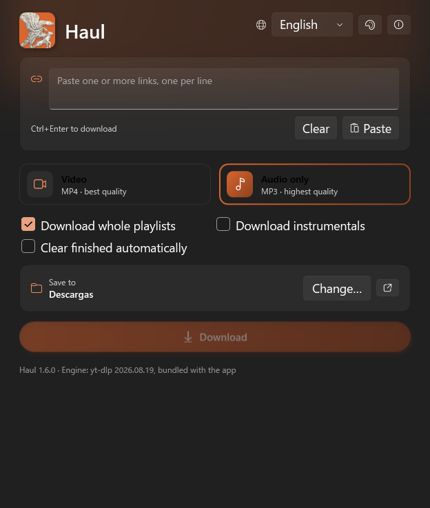
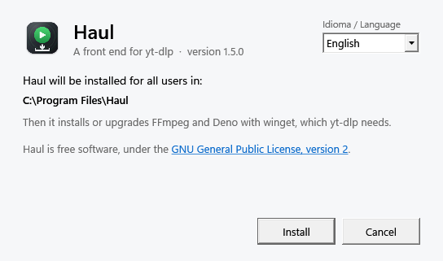
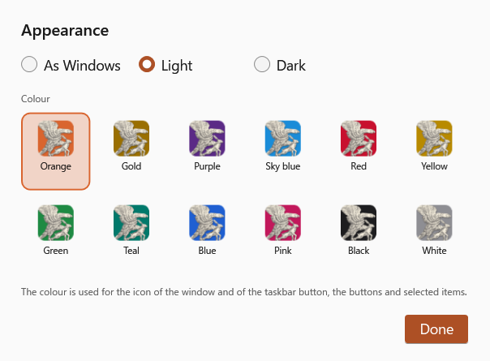

<p align="center"></p>

<h1 align="center">Haul for Windows</h1>
<p align="center"><b>Videos and music from the web to your folder, with yt-dlp doing the work.</b></p>

<p align="center"></p>

Gabriel Castiglia · November 11, 2026 · version 1.6.0 · GPL-2.0-only · built and tested with yt-dlp 2026.08.19

English · [Español](README.es.md)

macOS version: <https://github.com/Gabriel-Castiglia/haul> (Apple silicon only)

> **Windows 10/11 on x64 (64-bit Intel or AMD) only.** There is no build for ARM processors.

PDF manual: [`docs/Haul-manual-en.pdf`](docs/Haul-manual-en.pdf)

Haul is a Windows app that works as a front end for
[yt-dlp](https://github.com/yt-dlp/yt-dlp). The app builds the command, shows the progress and
manages a download queue. The actual work is done by yt-dlp, bundled with the app at a fixed,
verified version, and by ffmpeg. It is the Windows sibling of the macOS app of the same name: same
features, same formats, same behavior. The window can be light, dark or follow Windows, in one of
twelve colours, and the interface is available in English and Spanish; it starts in the language chosen in the setup
window, or in English, and remembers the choice.

## Requirements

- Windows 11, or Windows 10 version 1809 or later, on an x64 PC (64-bit Intel or AMD). Tested on Windows 11 Pro.
- [winget](https://learn.microsoft.com/windows/package-manager/winget/) (the "App Installer" from
  the Microsoft Store, included in Windows 11), which the setup program uses to install FFmpeg and
  Deno.

yt-dlp ships with the app, and Haul carries its own .NET runtime, so nothing has to be installed by
hand.

## Installation

Download `haul-setup.exe` from the
[latest release](https://github.com/Gabriel-Castiglia/haul-windows/releases/latest) and run it. The setup
window has a language menu in its top right corner, and every page changes language at once. It
installs Haul for all users in `C:\Program Files\Haul`, which takes administrator rights (Windows
asks for them when installation starts), and adds Haul to the Start menu. Then, as the user who ran
it, it installs FFmpeg and Deno with winget, or upgrades them if they are already there; yt-dlp needs
FFmpeg to join picture and sound and to convert to MP3, and Deno to solve JavaScript challenges. The
language chosen in the setup window is the one Haul uses when it starts for the first time.



| File | What it is |
|---|---|
| `haul-setup.exe` | Setup program, in English or Spanish. The usual way to install. |
| `haul.msi` | The same installation as a Windows Installer package, for silent installs: `msiexec /i haul.msi /qn`. It does not install FFmpeg and Deno; install them with `winget install yt-dlp.FFmpeg DenoLand.Deno`. |

Running a newer `haul-setup.exe` updates an installed Haul and keeps each user's settings. If Haul is
running, setup closes it before replacing its files. An installation made with the scripts of
version 1.4 or earlier (in `%LOCALAPPDATA%\Programs\Haul`) is removed, keeping its settings, so only
one Haul remains. An older version cannot be installed over a newer one.

The files are not signed with a commercial certificate, so the first time Windows SmartScreen may show
"Windows protected your PC". "More info" → "Run anyway" opens them. The `SHA256SUMS.txt` file of
each release lets you check the download first: `Get-FileHash haul-setup.exe`.

## Uninstallation

Open Settings → Apps → Installed apps, find Haul and choose Uninstall. The same setup window opens,
with its language menu. It closes Haul if it is running and removes the program and the Start menu
shortcut. Downloaded files and each user's settings (`%APPDATA%\Haul`) are kept, and FFmpeg and Deno
stay installed, because other programs may use them; `winget uninstall yt-dlp.FFmpeg DenoLand.Deno`
removes them.

## Usage

1. Paste one or more links into the box at the top. Links can be pasted on their own, one per
   line, or inside text copied from somewhere else; the app extracts them and drops duplicates. When
   the app opens or comes to the front with the box empty, it picks up the links on the clipboard.
2. Choose the format: Video (MP4) or Audio only (MP3).
3. Choose the destination folder. The first time it is Downloads; after that the app keeps the
   last folder chosen, and the format too.
4. Press Download or Ctrl+Enter. The box empties when the download starts, and a link already in the
   queue is not picked up again from the clipboard.

Links go into a queue and are downloaded one at a time. More links can be added while the queue
runs. Each row shows the thumbnail, title, percentage, speed and time remaining, and once finished
it offers to show the file in File Explorer or open it. Failed or cancelled downloads can be retried
or removed. A cancelled download deletes the partial files it had created; files that were already
in the folder, such as an earlier download of the same video in another format, are never touched.

Any row can be paused with its pause button and continued with its play button; the partial files
stay on disk meanwhile, so the download picks up where it stopped. "Pause all", above the queue,
holds the whole queue: the running download stops and waits first in line until "Resume all".
"Retry all" appears when some download failed and starts every failed one again. Rows can be
dragged with the mouse to change their order, and downloads start in the order of the list.

A download that fails is tried again up to four times, two seconds apart, and the row shows which
attempt is running ("Retry 2/4"). Partial files are kept between attempts, so yt-dlp resumes where
it stopped. When a download finishes, the app also deletes the intermediate files yt-dlp could not
remove by itself, such as the original audio of an MP3 while a file sync client held it
open.

The "Clear finished automatically" checkbox, below the format, is always in view, even with an
empty queue. While it is checked, every download that finishes or is cancelled leaves the
list by itself, and the summary keeps counting it; failed ones stay, so they can be retried. Checking
it also clears what had already finished. The app remembers the setting.

Videos with "instrumental" in the title wait in the queue, paused, unless "Download instrumentals" is
checked. A paused row can be downloaded on its own with its download button, and checking the option
resumes all of them.

The ⓘ button in the window shows the version, the meaning of the name, the author, the license and
the link to this repository, in the interface language. The button with the palette, next to it, opens
the appearance window. Everything from the header down to the
Download button stays fixed; only the queue scrolls, so adding links never moves the window.

The app can also be started with links from a terminal or a shortcut:

```
"C:\Program Files\Haul\Haul.exe" --descargar URL1 URL2
```

## Playlists

A playlist link or a channel page is
read first, without downloading anything, and every video becomes its own row in the queue, with its
thumbnail and its position ("Mix · 3/12"). The files go into a subfolder named after the playlist and
are numbered in playlist order: `01 - Title.mp4`, `02 - Title.mp4`, and so on. Each video can be
cancelled or retried on its own. A playlist with more than 200 videos asks for confirmation first.

A link to a video that was opened from a playlist brings the whole playlist while "Download whole
playlists" is checked, as it is by default. With the option unchecked, a card in the window asks each
time whether to download only that video or the whole playlist. The app remembers the setting. Other
links download as they are, one video each.

Some tag pages that group several posts, each with an embedded video, are read the same way: one
row per post, from the oldest to the newest, so a series keeps its episode order.

## Formats

| Format | Result | yt-dlp options |
|---|---|---|
| Video | MP4 with H.264 and AAC, at the highest resolution available in H.264 | `-f bv*+ba/b -S vcodec:h264,res,acodec:aac --merge-output-format mp4` |
| Audio only | MP3 at the highest quality | `-x --audio-format mp3 --audio-quality 0` |

H.264 is preferred because every Windows player handles it. Files are named after the video title.

## Repository layout

| Path | Contents |
|---|---|
| `fuentes/Haul/` | App source code (C#, WPF on .NET 10) |
| `fuentes/Haul/Core/` | Queue, playlists, links, settings and the yt-dlp process |
| `assets/` | The engraving the icon comes from |
| `scripts/make_icon.py` | Draws the icon in its twelve colours (Python 3 with numpy, opencv-python, scipy and Pillow); the same script makes the icon of the macOS version |
| `icono/Haul.ico`, `icono/icono-256.png`, `icono/icono-1024.png`, `icono/accents/` | The icon, on its default orange and on each colour |
| `scripts/screenshots.ps1` | Draws the pictures of the window in `docs/images` |
| `installer/Msi/` | The MSI package (WiX) |
| `installer/SetupUI/` | The setup window, in English and Spanish (.NET Framework 4.7.2, WPF), which also runs winget |
| `installer/Setup/` | The setup program that carries the setup window and the MSI (WiX bundle) |
| `scripts/build.ps1` | Checks the bundled yt-dlp and builds Haul, `haul.msi` and `haul-setup.exe` into `dist\` |
| `scripts/actualizar-yt-dlp.ps1` | Replaces the bundled yt-dlp with another verified release |
| `scripts/extraer_licencias.py` | Reads the third-party licenses stored inside `yt-dlp.exe` |
| `scripts/manual.sh` | Builds the PDF manuals and `README.txt`, `README.es.txt` from the READMEs (on macOS, with pandoc and Google Chrome) |
| `plugins/haul/` | Haul's own yt-dlp extractor plugin, for links the bundled version does not handle |
| `vendor/yt-dlp/` | Bundled copy of yt-dlp 2026.08.19, with sources, checksums, signature and licenses |
| `docs/Haul-manual-en.pdf`, `docs/Haul-manual-es.pdf` | PDF manuals, in English and Spanish |
| `docs/manual.css` | Stylesheet for the manuals |
| `README.md`, `README.es.md` | This documentation, in English and Spanish |
| `README.txt`, `README.es.txt` | Plain-text copies that the installer puts next to `Haul.exe` |
| `CHANGELOG.md` | Version history |

The `build\` and `dist\` folders and the compiler's `bin\` and `obj\` folders are generated and are
not part of the repository.

To build from source, with the [.NET 10 SDK](https://dotnet.microsoft.com/download) installed:

```
git clone https://github.com/Gabriel-Castiglia/haul-windows.git
cd haul-windows
powershell -ExecutionPolicy Bypass -File scripts\build.ps1
```

`build.ps1` refuses to build if the bundled `yt-dlp.exe` does not match its official checksums. It
publishes Haul as a self-contained `Haul.exe` with `yt-dlp.exe`, `plugins\` and `licenses\` next to
it, and builds `dist\haul.msi` and `dist\haul-setup.exe`; the WiX Toolset is restored automatically
as a NuGet package. The version is set in one place, `fuentes\Haul\Haul.csproj`.

## Window and theme

The window cannot be made smaller than 560 × 720, so its contents always stay readable; below that
height the queue scrolls, while everything above it stays fixed. Size and position are remembered between
sessions.

The app uses the Windows 11 Fluent theme, light, dark or as Windows (the setting for apps in Settings >
Personalization > Colors, followed while the app is open). The palette button in the header opens the
appearance window, which also has twelve colours: the one chosen colours the buttons, check boxes and
selected items, and the icon of the window and of its taskbar button, where the eagle flies on a tile of
that colour. The icon of the Start menu stays orange, because Haul is installed for all users and that
shortcut belongs to all of them. A settings file from an earlier version keeps the dark window it had; a
new installation follows Windows.



## New versions

Once a day Haul asks GitHub for the number of the latest version. If it is newer, a small window says so
and offers to open the download page; Haul never downloads or installs a new version by itself. The
request carries nothing but the program name and its version. The ⓘ window turns it off ("Tell me when
there is a new version") and asks at any time ("Check for a new version").

## Maintenance

Haul is built and tested with yt-dlp 2026.08.19, and that exact copy ships with the app. A pinned
version keeps the behavior stable and does not depend on the yt-dlp repository staying online. The
trade-off is that sites change often, and sooner or later a fixed version stops working with them.
When that happens, a new release of Haul moves to a newer yt-dlp:

```
powershell -ExecutionPolicy Bypass -File scripts\actualizar-yt-dlp.ps1 <version>
powershell -ExecutionPolicy Bypass -File scripts\build.ps1
```

The first script downloads the release, verifies its signature with the key stored in
`vendor\yt-dlp\public.key` (using the gpg that ships with Git for Windows) and its SHA-256
checksums, and only then replaces the files and refreshes the license texts. It needs Python to read
the licenses stored inside `yt-dlp.exe`. Running the new `haul-setup.exe` also upgrades FFmpeg and
Deno.

The most common yt-dlp errors are shown in plain words in the interface language (video
unavailable, private video, unsupported site, missing playlist, no connection); anything else
appears exactly as yt-dlp prints it.

Preferences (language, folder, format, window size, appearance, colour, "Clear finished automatically",
"Download instrumentals" and the notice of new versions)
are stored in `%APPDATA%\Haul\settings.json`.
Deleting that file resets them.

## Technical notes

The app runs the bundled `yt-dlp.exe` as a hidden child process. An app started from the Start menu
inherits the `PATH` that File Explorer had when it started, which misses tools installed afterwards
with winget, so Haul rebuilds `PATH` from the registry and passes ffmpeg's location to yt-dlp. To
avoid depending on the text yt-dlp prints for a terminal, it asks for output in a custom,
tab-separated format, the same as the macOS version:

| Line | Contents | Source |
|---|---|---|
| `META` | id, channel, uploader, title and thumbnail, checked before downloading | `-O pre_process:…` |
| `INFO` | title, uploader, duration, thumbnail and file name | `-O before_dl:…` |
| `AVANCE` | percentage, speed and time remaining | `--progress-template` |
| `ARCHIVO` | final file path | `-O after_move:…` |

Paused instrumentals are held back with `--match-filters`, so yt-dlp downloads nothing until they
are allowed.

Some links fail inside yt-dlp itself, its latest release included: a video page that now asks for an
account although its embedded player does not, and pages whose data moved to a different place.
Haul ships a yt-dlp extractor plugin of its own in `plugins/haul/`, installed in a `plugins` folder
next to `yt-dlp.exe` and passed with `--plugin-dirs`. Plugin extractors are tried before the
built-in ones, and each one only matches the links it fixes. When the embedded player answers with
an occasional 401 error, the plugin retries up to three times.

Playlists are read with `--flat-playlist -J`, which lists the videos without downloading them.
Cancelling stops yt-dlp together with ffmpeg (the whole process tree). With `-O`, yt-dlp prints
nothing else, so the files of a download are recognized by the file name in its `INFO` line: when
the download starts, the app notes which files with that name already exist, and on cancelling it
deletes only the new ones.

## Credits

Haul is a front end; the hard work belongs to these projects:

| Project | Role in Haul | License |
|---|---|---|
| [yt-dlp](https://github.com/yt-dlp/yt-dlp), by the yt-dlp contributors, fork of youtube-dl | Download engine, bundled in `vendor/yt-dlp` | [Unlicense](https://github.com/yt-dlp/yt-dlp/blob/master/LICENSE) |
| Components inside `yt-dlp.exe`: Python, OpenSSL, curl, curl_cffi, certifi, mutagen, websockets, brotli and others | Runtime and libraries of the Windows executable | Their own licenses, listed in `vendor/yt-dlp/licenses/yt-dlp-exe-THIRD_PARTY_LICENSES.txt` |
| [yt-dlp-ejs](https://github.com/yt-dlp/ejs), included in yt-dlp | JavaScript challenge solver | Unlicense |
| [meriyah](https://github.com/meriyah/meriyah), by KFlash and others, inside yt-dlp-ejs | JavaScript parser | [ISC](https://github.com/meriyah/meriyah/blob/main/LICENSE.md) |
| [astring](https://github.com/davidbonnet/astring), by David Bonnet, inside yt-dlp-ejs | JavaScript code generator | [MIT](https://github.com/davidbonnet/astring/blob/main/LICENSE) |
| [FFmpeg](https://ffmpeg.org), build by the yt-dlp project, installed with winget, not bundled | Merges picture and sound, converts to MP3 | [GPL-3.0+](https://ffmpeg.org/legal.html) for this build |
| [Deno](https://deno.com), installed with winget | JavaScript runtime used by yt-dlp | [MIT](https://github.com/denoland/deno/blob/main/LICENSE.md) |
| [.NET](https://dotnet.microsoft.com) and WPF, inside `Haul.exe` | Runtime and user interface framework | [MIT](https://github.com/dotnet/wpf/blob/main/LICENSE.TXT) |
| [WiX Toolset](https://wixtoolset.org), only to build the installers | MSI package and setup program | [MS-RL](https://github.com/wixtoolset/wix/blob/main/LICENSE.TXT) |
| [Segoe Fluent Icons](https://learn.microsoft.com/windows/apps/design/style/segoe-fluent-icons-font), part of Windows | Icons of the interface | Windows license |
| [pandoc](https://pandoc.org), only to build the PDF manuals | Markdown to HTML conversion | [GPL-2.0+](https://github.com/jgm/pandoc/blob/main/COPYRIGHT) |

The license texts of the bundled components are in `vendor/yt-dlp/licenses/` and are installed
next to the app, under `licenses\`.

## License

Copyright (C) 2026 Gabriel Castiglia.

Haul is free software, released under the GNU General Public License, version 2
(GPL-2.0-only), the same license as the Linux kernel. It may be used, studied, modified and
redistributed; any modified version that is distributed must be released under the same license,
together with its source code. The full text is in [`LICENSE`](LICENSE).

Haul includes an unmodified copy of yt-dlp in `vendor/yt-dlp`, which keeps its own licenses
(Unlicense, plus the licenses of the components inside `yt-dlp.exe`) and is not covered by the GPL.
Haul runs yt-dlp and ffmpeg as separate programs and does not link to them; ffmpeg is not bundled.

The icon is the eagle carrying a hare from the engraving "Eagle bringing a young woman a hare" by the
Monogrammist B (Italy, 17th century), Rijksmuseum, public domain (CC0).
