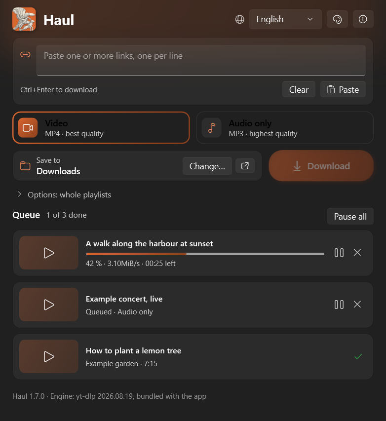
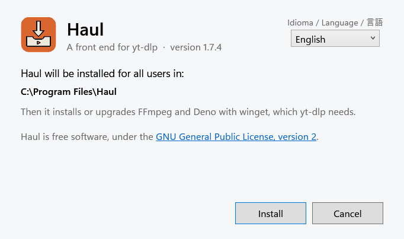
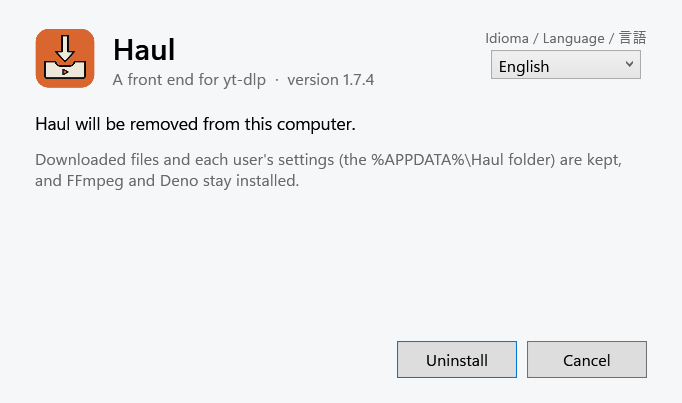
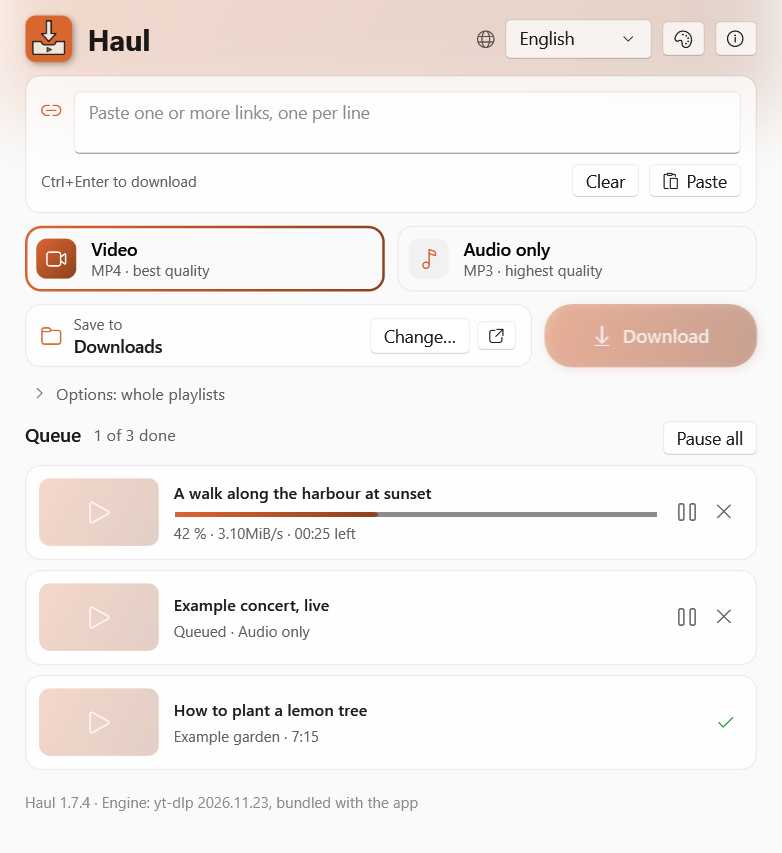
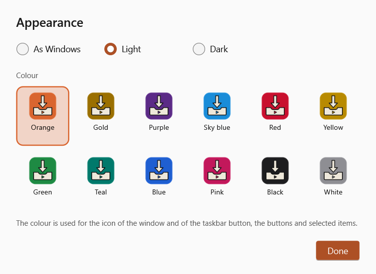
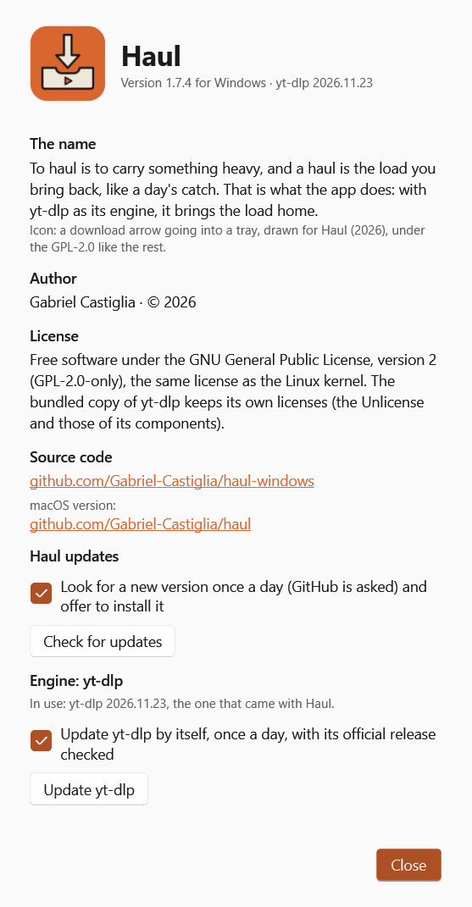
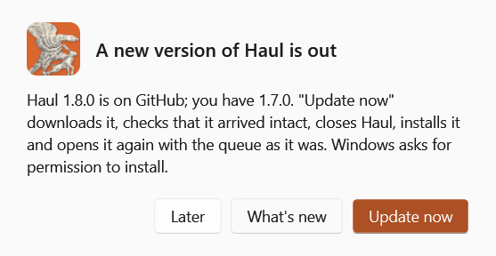

<p align="center"></p>

<h1 align="center">Haul for Windows</h1>
<p align="center"><b>Videos and music from the web to your folder, with yt-dlp doing the work.</b></p>

<p align="center"></p>

Gabriel Castiglia · November 27, 2026 · version 1.8.0 · GPL-2.0-only · built and tested with yt-dlp 2026.11.23

English · [Español](README.es.md) · [日本語](README.ja.md)

macOS version: <https://github.com/Gabriel-Castiglia/haul> (Apple silicon only)

> **Windows 10/11 on x64 (64-bit Intel or AMD) only.** There is no build for ARM processors.

PDF manual: [`docs/Haul-manual-en.pdf`](docs/Haul-manual-en.pdf)

Haul is a Windows app that works as a front end for
[yt-dlp](https://github.com/yt-dlp/yt-dlp). The app builds the command, shows the progress and
manages a download queue. The actual work is done by yt-dlp, bundled with the app at a fixed,
verified version, and by ffmpeg. It is the Windows sibling of the macOS app of the same name: same
features, same formats, same behavior. The window can be light, dark or follow Windows, in one of
twelve colours, and the interface is available in English, Spanish and Japanese; it starts in the language chosen in the
setup window or, without one, in the language of Windows when it is Spanish or Japanese (English otherwise), and
remembers the choice. Haul keeps itself up to date, and keeps yt-dlp up to date too.

## Requirements

- Windows 11, or Windows 10 version 1809 or later, on an x64 PC (64-bit Intel or AMD). Tested on Windows 11 Pro.
- [winget](https://learn.microsoft.com/windows/package-manager/winget/) (the "App Installer" from
  the Microsoft Store, included in Windows 11), which the setup program uses to install FFmpeg and
  Deno.
- An internet connection, to download and to check for updates.

yt-dlp ships with the app, and Haul carries its own .NET runtime, so nothing has to be installed by
hand.

## Installation

Download `haul-setup.exe` from the
[latest release](https://github.com/Gabriel-Castiglia/haul-windows/releases/latest) and run it. The setup
window starts in the language of an installed Haul, or in Spanish or Japanese on a Windows in that language, or else
in English;
its language menu, in the top right corner, changes every page at once. It
installs Haul for all users in `C:\Program Files\Haul`, which takes administrator rights (Windows
asks for them when installation starts), and adds Haul to the Start menu. Then, as the user who ran
it, it installs FFmpeg and Deno with winget, or upgrades them if they are already there; yt-dlp needs
FFmpeg to join picture and sound and to convert to MP3, and Deno to solve JavaScript challenges. The
language chosen in the setup window is the one Haul uses when it starts for the first time.



| File | What it is |
|---|---|
| `haul-setup.exe` | Setup program, in English, Spanish or Japanese. The usual way to install. |
| `haul.msi` | The same installation as a Windows Installer package, for silent installs: `msiexec /i haul.msi /qn`. It does not install FFmpeg and Deno; install them with `winget install yt-dlp.FFmpeg DenoLand.Deno`. |

Running a newer `haul-setup.exe` updates an installed Haul and keeps each user's settings. If Haul is
running, setup closes it before replacing its files. An installation made with the scripts of
version 1.4 or earlier (in `%LOCALAPPDATA%\Programs\Haul`) is removed, keeping its settings, so only
one Haul remains. An older version cannot be installed over a newer one. Haul can also update itself:
see [Updates](#updates).

The files are not signed with a commercial certificate, so the first time Windows SmartScreen may show
"Windows protected your PC". "More info" → "Run anyway" opens them. The `SHA256SUMS.txt` file of
each release lets you check the download first: `Get-FileHash haul-setup.exe`.

## Uninstallation

Open Settings → Apps → Installed apps, find Haul and choose Uninstall. The same setup window opens,
with its language menu. It closes Haul if it is running and removes the program and the Start menu
shortcut. Downloaded files and each user's settings and saved queue (`%APPDATA%\Haul`) are kept, as is
any copy of yt-dlp that Haul downloaded (`%LOCALAPPDATA%\Haul`); deleting those two folders removes
them. FFmpeg and Deno stay installed, because other programs may use them;
`winget uninstall yt-dlp.FFmpeg DenoLand.Deno` removes them.



## Usage

1. Paste one or more links into the box at the top, or press Paste. Links can be pasted on their own,
   one per line, or inside text copied from somewhere else; the app extracts them and drops duplicates.
   When the app opens or comes to the front with the box empty, it picks up the links on the clipboard.
2. Choose the format: Video (MP4) or Audio only (MP3).
3. Choose the destination folder with "Change…". The first time it is Downloads; after that the app
   keeps the last folder chosen, and the format too.
4. Press Download or Ctrl+Enter. The box empties when the download starts, and a link already in the
   queue is not picked up again from the clipboard.

The app can also be started with links from a terminal or a shortcut:

```
"C:\Program Files\Haul\Haul.exe" --descargar URL1 URL2
```

## The main window



| Part | What it does |
|---|---|
| Language menu (globe) | Switches the interface between English, Spanish and Japanese (日本語) at once; the choice is remembered. |
| Palette button | Opens the appearance window: light, dark or as Windows, and the colour (see [Window and theme](#window-and-theme)). |
| ⓘ button | Opens "About Haul": version, the name, author, license, source code and the update settings (see [Updates](#updates)). |
| Link box | Takes the links. The line below it counts them ("2 links · Ctrl+Enter to download") or says "No links found". "Clear" empties the box; "Paste" pastes the clipboard. |
| Video / Audio only | The format: "MP4 · best quality" or "MP3 · highest quality" (see [Formats](#formats)). |
| Save to | The destination folder. "Change…" chooses another one; the button next to it opens it in File Explorer. |
| Download | Starts the download. It reads "Download 3 links" with several links, and "Add to queue" while the queue is running. |
| Options | The three options, folded by default (see [Options](#options)). |
| Queue | The downloads, one per row, with a summary ("2 of 5 done · 1 failed · 1 paused") and the buttons "Cancel all", "Pause all", "Resume all" and "Retry all", each shown when it applies. |
| Bottom line | The version of Haul and of yt-dlp ("bundled with the app" or "updated by Haul"), and the progress of an update. |

If yt-dlp, ffmpeg or Deno cannot be found, a notice above the queue says which one is missing
("ffmpeg missing. Run haul-setup.exe again; it installs FFmpeg and Deno with winget.").

Everything from the header down to the options stays fixed; only the queue scrolls, so adding links
never moves the window.

## The queue

Links go into a queue and are downloaded one at a time. More links can be added while the queue
runs. Each row shows the thumbnail, title, percentage, speed and time remaining, and what is being
done ("Preparing…", "Merging picture and sound…", "Converting to MP3…"). A finished row shows the
channel and the duration, with buttons to show the file in File Explorer ("Show in File Explorer")
or open it ("Open"). Each row has the buttons that apply to it, with a tooltip: "Pause", "Resume",
"Cancel this download", "Try again", "Remove from queue". A cancelled download deletes the partial
files it had created; files that were already in the folder, such as an earlier download of the same
video in another format, are never touched.

Any row can be paused with its pause button and continued with its play button; the partial files
stay on disk meanwhile, so the download picks up where it stopped. "Pause all", above the queue,
holds the whole queue: the running download stops and waits first in line until "Resume all".
"Cancel all" cancels everything that has not finished. "Retry all" appears when some download failed
and starts every failed one again. Downloads start in the order of the list, which can be changed by
dragging rows with the mouse or from the keyboard: Tab reaches each row and its buttons, and Alt+Up
or Alt+Down moves the row one place. The row's menu (right-click, Shift+F10 or the menu key) has
the same moves, "Move up" and "Move down".

A download that fails is tried again up to four times, two seconds apart, and the row shows which
attempt is running ("Retry 2/4"). Partial files are kept between attempts, so yt-dlp resumes where
it stopped. If all attempts fail, the row turns red with the reason (see [Troubleshooting](#troubleshooting))
once yt-dlp has exited; until then it can only be cancelled.
When a download finishes, the app also deletes the intermediate files yt-dlp could not remove by
itself, such as the original audio of an MP3 while a file sync client held it open.

The queue survives closing Haul: what is queued, paused or failed, and the links still waiting to be
added, come back the next time it opens, in the same order. A download that was running when Haul
closed comes back queued and carries on from its partial files; a playlist that was being read is read
again. Finished and cancelled rows are not kept. The queue is saved in `%APPDATA%\Haul\queue.json`,
always through a temporary file that then replaces the old one, so a crash never leaves half a file;
a damaged file is set aside as `queue.damaged.json` and Haul starts with an empty queue.

## Options

"Download whole playlists", "Download instrumentals" and "Clear finished automatically" are under
"Options", below the Download button. The line is folded by default, to leave room for the queue, and
lists the options that are on ("Options: whole playlists"); a click opens it, and Haul remembers
whether it was left open. Each option has a tooltip that explains it, and the app remembers them.

| Option | When on | When off |
|---|---|---|
| Download whole playlists (on by default) | A video opened from a playlist brings the whole playlist. | A card asks every time (see [Playlists](#playlists)). |
| Download instrumentals | Videos with "instrumental" in the title download like the rest. | They wait in the queue, paused ("Paused: it is an instrumental"). |
| Clear finished automatically | Every download that finishes or is cancelled leaves the list by itself; the summary keeps counting it. Failed ones stay, so they can be retried. Checking it also clears what had already finished. | Finished rows stay until they are removed. |

A paused instrumental can be downloaded on its own with its download button ("Download anyway"), and
checking "Download instrumentals" resumes all of them.

## Playlists

A playlist link or a channel page is read first, without downloading anything ("Reading the
playlist…"), and every video becomes its own row in the queue, with its thumbnail and its position
("Mix · 3/12"). The files go into a subfolder named after the playlist and are numbered in playlist
order: `01 - Title.mp4`, `02 - Title.mp4`, and so on. Each video can be cancelled or retried on its
own. A playlist with more than 200 videos asks for confirmation first ("A large playlist": "Add 250"
or "Cancel").

A link to a video that was opened from a playlist brings the whole playlist while "Download whole
playlists" is checked, as it is by default. With the option unchecked, a card in the window asks each
time ("This video is part of a playlist"): "The whole playlist", "Only this video" or "Cancel". Other
links download as they are, one video each.

Some tag pages that group several posts, each with an embedded video, are read the same way: one
row per post, from the oldest to the newest, so a series keeps its episode order.

## Formats

| Format | Result | yt-dlp options |
|---|---|---|
| Video | MP4 with H.264 and AAC, at the highest resolution available in H.264 | `-f bv*+ba/b -S vcodec:h264,res,acodec:aac --merge-output-format mp4` |
| Audio only | MP3 at the highest quality | `-x --audio-format mp3 --audio-quality 0` |

H.264 is preferred because every Windows player handles it. Files are named after the video title.
There is no quality menu: Haul always asks for the best the site offers in that format.

## Window and theme

The window is compact, so the queue keeps room for several rows even on a 1366 × 768 or 1280 × 720
screen with Windows scaled to 125 % or 150 %: the destination folder and the Download button share a
line, and the options fold away. It cannot be made smaller than 560 × 420. When the window is so low
that the queue would have room for less than two rows, the part above the queue scrolls together with
it instead of squeezing it, and goes back to its fixed place when the window grows. Size and position
are remembered between sessions.

The app uses the Windows 11 Fluent theme, light, dark or as Windows (the setting for apps in Settings >
Personalization > Colors, followed while the app is open). The palette button in the header opens the
appearance window, which also has twelve colours: Orange (the default), Gold, Purple, Sky blue, Red,
Yellow, Green, Teal, Blue, Pink, Black and White. The one chosen colours the buttons, check boxes and
selected items, and the icon of the window and of its taskbar button, where the arrow and the tray sit
on a tile of that colour. The icon of the Start menu stays orange, because Haul is installed for all
users and that shortcut belongs to all of them. The colour tiles can also be reached with Tab and
chosen with Enter or Space, and screen readers read their names. A settings file from an earlier version keeps the dark
window it had; a new installation follows Windows.



## Updates

The ⓘ button opens "About Haul", which holds the update settings of Haul and of yt-dlp.



**Haul.** Once a day (while "Look for a new version once a day" is checked, as it is by default) and
whenever "Check for updates" is pressed, Haul asks GitHub for its latest release. If it is newer, a
small window asks once: "Update now", "What's new" (opens the release page) or "Later". Pressing "Check
for updates" while a check, a download or the wait for the queue is under way says so ("An update of
Haul is already under way"), and its progress shows in the bottom line.



With "Update now" everything happens by itself: Haul first checks that the release's `SHA256SUMS.txt`
carries the author's signature (`release.sig`, checked against two keys built into Haul; a release without a
valid one is refused, and can only be downloaded by hand from its page), then downloads `haul-setup.exe` and
checks it against that `SHA256SUMS.txt`; a file that does not match is deleted and never run. Right
before it runs, the file is checked again and kept open so that no other program can change, replace or
delete it until Haul has closed.
If a download is running, Haul asks first ("There are downloads in the queue"): "Update now" (the
download stops and carries on from its partial files when Haul comes back), "When the queue ends" or
"Cancel". Then it saves the queue, closes, and runs the setup program in silence, keeping the language
chosen at installation; Windows asks for permission, because Haul is installed for all users. The setup
program waits for Haul to be gone, installs, and opens Haul again with its queue. If the installation
did not happen (for example, because the permission was refused), the Haul that opens says so. The
request to GitHub carries nothing but the program name and its version.

The silent update is the setup program's own: `haul-setup.exe /quiet /norestart /HAULWAITPID=<pid>
/HAULRELAUNCH=1` waits for that process to end and opens Haul at the end. It does not touch FFmpeg and
Deno; running `haul-setup.exe` by hand upgrades them.

**yt-dlp.** Sites change often, so Haul can also bring a newer yt-dlp than the one it was installed
with. Once a day (while "Update yt-dlp by itself" is checked, as it is by default) and whenever
"Update yt-dlp" is pressed, Haul asks GitHub for yt-dlp's latest official release. A newer one
is downloaded to `%LOCALAPPDATA%\Haul\yt-dlp\<version>\`, checked against the release's `SHA2-256SUMS`,
and run once to confirm its version number; only then Haul starts using it, and the bottom line of the
window says "updated by Haul". A download already running finishes with the copy it started with; the
next ones use the new copy. The copy installed with Haul is never changed and is used again whenever no
newer checked copy exists; older downloaded copies are removed when Haul starts. The "Engine: yt-dlp"
part of the About window says which copy is in use.

## Troubleshooting

The most common yt-dlp errors are shown in plain words in the interface language; anything else
appears exactly as yt-dlp prints it.

| Message or symptom | What it means, what to do |
|---|---|
| "That format is not available for this video." | Usually the site changed and this yt-dlp no longer reads it. Press "Update yt-dlp" in the ⓘ window, then "Try again" on the row. |
| "The site asks to confirm you are not a bot; install the latest version of Haul." | Update yt-dlp, and Haul ("Check for updates"). |
| "The video is unavailable (removed, private or blocked)." · "This is a private video." | The site does not offer the video to anyone without access; Haul cannot download it. |
| "Age confirmation with an account is required; it cannot be downloaded." | Haul does not sign in to sites, so these videos cannot be downloaded. |
| "That site is not supported by yt-dlp." · "That does not look like a valid link." | Check the link; yt-dlp does not know that site. |
| "The page could not be opened; check the connection." | No connection, or the site did not answer. "Try again" later. |
| "That channel has no videos to download." · "The playlist does not exist or is private." | The channel or playlist has nothing public to download. |
| "ffmpeg missing. Run haul-setup.exe again; it installs FFmpeg and Deno with winget." | Run `haul-setup.exe` again, or `winget install yt-dlp.FFmpeg DenoLand.Deno`. Without ffmpeg, picture and sound are not joined and MP3 is not made. |
| "Could not start yt-dlp: …" · "yt-dlp exited with code …" | The program files are damaged or blocked (for example by an antivirus). Run `haul-setup.exe` again. |
| "The saved queue was damaged and was set aside as queue.damaged.json" | Haul started with an empty queue; the old file stays in `%APPDATA%\Haul` for inspection. |
| "Haul … was not installed (perhaps Windows' permission was not given)." | The update was not installed. Try again from ⓘ › "Check for updates" and allow the Windows prompt. |
| "The signature of this release is not valid: nothing was downloaded or installed." | The release does not carry the author's valid signature; Haul refuses it. Download it by hand from its page only if you trust it. |
| "yt-dlp could not be updated: …" | The previous yt-dlp stays in use; try again later. |
| "An update of Haul is already under way; its progress shows at the bottom of the window." | "Check for updates" was pressed during an update; wait for it to end. |
| "Windows protected your PC" when running the setup | The setup is not signed with a commercial certificate: "More info" → "Run anyway". |

Preferences (language, folder, format, window size and position, appearance, colour, the options and
whether they are folded, and the update settings) are stored in `%APPDATA%\Haul\settings.json`, and the
queue in `%APPDATA%\Haul\queue.json`. Deleting `settings.json` while Haul is closed resets the
preferences.

## Responsible use

Haul downloads what a site already lets anyone watch, and only through yt-dlp. Downloading may be
restricted by copyright law and by the terms of use of each site. Use Haul only for content you have
the right to keep: your own, content under a free license or in the public domain, or content whose
rights holder allows it, and follow the law of your country. Haul and yt-dlp do not decrypt
DRM-protected content. Haul comes without any warranty (see [License](#license)).

## Maintenance

Haul is built and tested with yt-dlp 2026.11.23, and that exact copy ships with the app. A pinned
version keeps the behavior stable and does not depend on the yt-dlp repository staying online. The
trade-off is that sites change often, and sooner or later a fixed version stops working with them;
between releases of Haul, the in-app update of yt-dlp covers that (see [Updates](#updates)). A new
release of Haul moves the bundled copy to a newer yt-dlp:

```
powershell -ExecutionPolicy Bypass -File scripts\actualizar-yt-dlp.ps1 <version>
powershell -ExecutionPolicy Bypass -File scripts\build.ps1
```

The first script downloads the release, verifies its signature with the key stored in
`vendor\yt-dlp\public.key` (using the gpg that ships with Git for Windows) and its SHA-256
checksums, and only then replaces the files and refreshes the license texts. It needs Python to read
the licenses stored inside `yt-dlp.exe`. Running the new `haul-setup.exe` also upgrades FFmpeg and
Deno.

## Repository layout

| Path | Contents |
|---|---|
| `fuentes/Haul/` | App source code (C#, WPF on .NET 10) |
| `fuentes/Haul/Core/` | Queue and its saved copy, playlists, links, settings, updates, the yt-dlp process and the interface texts in English, Spanish and Japanese (`Textos.cs`) |
| `assets/icon.svg` | The drawing of the icon (made in its twelve colours by the author's icon tool, the same for the macOS version) |
| `icono/Haul.ico`, `icono/icono-256.png`, `icono/icono-1024.png`, `icono/accents/` | The icon, on its default orange and on each colour |
| `installer/Msi/` | The MSI package (WiX) |
| `installer/SetupUI/` | The setup window, in English, Spanish and Japanese (.NET Framework 4.7.2, WPF; its texts in `SetupTexts.cs`), which also runs winget |
| `installer/Setup/` | The setup program that carries the setup window and the MSI (WiX bundle) |
| `scripts/build.ps1` | Checks the bundled yt-dlp and builds Haul, `haul.msi` and `haul-setup.exe` into `dist\` |
| `scripts/actualizar-yt-dlp.ps1` | Replaces the bundled yt-dlp with another verified release |
| `scripts/extraer_licencias.py` | Reads the third-party licenses stored inside `yt-dlp.exe` |
| `scripts/screenshots.ps1` | Draws the pictures of the windows and of the setup window in `docs/images`, in the three languages, with example data |
| `scripts/manual.sh` | Builds the three PDF manuals and `README.txt`, `README.es.txt`, `README.ja.txt` from the READMEs (on macOS, or in Git Bash on Windows, with pandoc and Google Chrome or Microsoft Edge) |
| `plugins/haul/` | Haul's own yt-dlp extractor plugin, for links the bundled version does not handle |
| `vendor/yt-dlp/` | Bundled copy of yt-dlp 2026.11.23, with sources, checksums, signature and licenses |
| `docs/Haul-manual-en.pdf`, `docs/Haul-manual-es.pdf`, `docs/Haul-manual-ja.pdf` | PDF manuals, in English, Spanish and Japanese |
| `docs/manual.css`, `docs/images/` | Stylesheet and pictures of the manuals |
| `README.md`, `README.es.md`, `README.ja.md` | This documentation, in English, Spanish and Japanese |
| `README.txt`, `README.es.txt`, `README.ja.txt` | Plain-text copies that the installer puts next to `Haul.exe` |
| `CHANGELOG.md`, `CHANGELOG.es.md`, `CHANGELOG.ja.md` | Version history, in English, Spanish and Japanese |

The `build\` and `dist\` folders and the compiler's `bin\` and `obj\` folders are generated and are
not part of the repository.

To build from source, with the [.NET 10 SDK](https://dotnet.microsoft.com/download) installed:

```
git clone https://github.com/Gabriel-Castiglia/haul-windows.git
cd haul-windows
powershell -ExecutionPolicy Bypass -File scripts\build.ps1
```

`build.ps1` refuses to build if the bundled `yt-dlp.exe` does not match its official checksums. It
publishes Haul as a self-contained `Haul.exe` with `yt-dlp.exe`, `plugins\` and `licenses\` next to
it, and builds `dist\haul.msi` and `dist\haul-setup.exe`; the WiX Toolset is restored automatically
as a NuGet package. The version is set in one place, `fuentes\Haul\Haul.csproj`.

`Haul.exe --self-test <log>` checks the interface texts of Haul and of the setup window (the three
languages must have the same keys and placeholders), the saved queue, moving rows, the version logic of
Haul and yt-dlp, the checksum lists and the arguments yt-dlp starts with, with throw-away data, without a window and without touching the user's settings or
queue; the exit code is the number of failures. `--red` adds checks against GitHub, including a real
yt-dlp update into the temporary folder.

## Technical notes

The app runs the bundled `yt-dlp.exe` as a hidden child process, always with `--ignore-config`: yt-dlp
reads no configuration file, neither the user's (`%APPDATA%\yt-dlp\config` and the like) nor a
`yt-dlp.conf` that a web page could have left in the download folder, so the result never depends on
files outside Haul. It also runs with `--no-plugin-dirs` and then `--plugin-dirs` with Haul's own `plugins`
folder, so the only plugins yt-dlp loads are Haul's: none from `%APPDATA%\yt-dlp\plugins` or the other
folders yt-dlp searches by default, where any program could leave Python code. An app started from the Start menu
inherits the `PATH` that File Explorer had when it started, which misses tools installed afterwards
with winget, so Haul rebuilds `PATH` from the registry and passes ffmpeg's location to yt-dlp. To
avoid depending on the text yt-dlp prints for a terminal, it asks for output in a custom,
tab-separated format, the same as the macOS version:

| Line | Contents | Source |
|---|---|---|
| `META` | id, channel, uploader, title and thumbnail, checked before downloading | `-O pre_process:…` |
| `INFO` | title, uploader, duration, thumbnail and file name | `-O before_dl:…` |
| `AVANCE` | percentage, speed and time remaining | `--progress-template` |
| `ARCHIVO` | final file path | `-O after_move:…` |

Paused instrumentals are held back with `--match-filters`, so yt-dlp downloads nothing until they
are allowed.

Some links fail inside yt-dlp itself, its latest release included: a video page that now asks for an
account although its embedded player does not, and pages whose data moved to a different place.
Haul ships a yt-dlp extractor plugin of its own in `plugins/haul/`, installed in a `plugins` folder
next to `yt-dlp.exe` and passed with `--plugin-dirs` (the only plugin folder yt-dlp uses). Plugin extractors are tried before the
built-in ones, and each one only matches the links it fixes. When the embedded player answers with
an occasional 401 error, the plugin retries up to three times.

Playlists are read with `--flat-playlist -J`, which lists the videos without downloading them.
Every yt-dlp runs in a Windows job object together with the processes it starts. Cancelling stops yt-dlp
together with ffmpeg (the whole process tree). The end of each process is awaited off the window's
thread: once yt-dlp has exited, its output gets ten seconds to close, and if a process it left behind
still holds it open, the whole job is stopped, so the window never freezes waiting for it. With `-O`, yt-dlp prints
nothing else, so the files of a download are recognized by the file name in its `INFO` line: when
the download starts, the app notes which files with that name already exist, and on cancelling it
deletes only the new ones.

## Credits

Haul is a front end; the hard work belongs to these projects:

| Project | Role in Haul | License |
|---|---|---|
| [yt-dlp](https://github.com/yt-dlp/yt-dlp), by the yt-dlp contributors, fork of youtube-dl | Download engine, bundled in `vendor/yt-dlp` | [Unlicense](https://github.com/yt-dlp/yt-dlp/blob/master/LICENSE) |
| Components inside `yt-dlp.exe`: Python, OpenSSL, curl, curl_cffi, certifi, mutagen, websockets, brotli and others | Runtime and libraries of the Windows executable | Their own licenses, listed in `vendor/yt-dlp/licenses/yt-dlp-exe-THIRD_PARTY_LICENSES.txt` |
| [yt-dlp-ejs](https://github.com/yt-dlp/ejs), included in yt-dlp | JavaScript challenge solver | Unlicense |
| [meriyah](https://github.com/meriyah/meriyah), by KFlash and others, inside yt-dlp-ejs | JavaScript parser | [ISC](https://github.com/meriyah/meriyah/blob/main/LICENSE.md) |
| [astring](https://github.com/davidbonnet/astring), by David Bonnet, inside yt-dlp-ejs | JavaScript code generator | [MIT](https://github.com/davidbonnet/astring/blob/main/LICENSE) |
| [FFmpeg](https://ffmpeg.org), build by the yt-dlp project, installed with winget, not bundled | Merges picture and sound, converts to MP3 | [GPL-3.0+](https://ffmpeg.org/legal.html) for this build |
| [Deno](https://deno.com), installed with winget | JavaScript runtime used by yt-dlp | [MIT](https://github.com/denoland/deno/blob/main/LICENSE.md) |
| [.NET](https://dotnet.microsoft.com) and WPF, inside `Haul.exe` | Runtime and user interface framework | [MIT](https://github.com/dotnet/wpf/blob/main/LICENSE.TXT) |
| [WiX Toolset](https://wixtoolset.org), only to build the installers | MSI package and setup program | [MS-RL](https://github.com/wixtoolset/wix/blob/main/LICENSE.TXT) |
| [Segoe Fluent Icons](https://learn.microsoft.com/windows/apps/design/style/segoe-fluent-icons-font), part of Windows | Icons of the interface | Windows license |
| [pandoc](https://pandoc.org), only to build the PDF manuals | Markdown to HTML conversion | [GPL-2.0+](https://github.com/jgm/pandoc/blob/main/COPYRIGHT) |

The license texts of the bundled components are in `vendor/yt-dlp/licenses/` and are installed
next to the app, under `licenses\`.

## License

Copyright (C) 2026 Gabriel Castiglia.

Haul is free software, released under the GNU General Public License, version 2
(GPL-2.0-only), the same license as the Linux kernel. It may be used, studied, modified and
redistributed; any modified version that is distributed must be released under the same license,
together with its source code. It is distributed without any warranty. The full text is in
[`LICENSE`](LICENSE).

Haul includes an unmodified copy of yt-dlp in `vendor/yt-dlp`, which keeps its own licenses
(Unlicense, plus the licenses of the components inside `yt-dlp.exe`) and is not covered by the GPL.
Haul runs yt-dlp and ffmpeg as separate programs and does not link to them; ffmpeg is not bundled.

The icon, a download arrow going into a tray, was drawn for Haul (2026) and is under the GPL-2.0 like the rest.

Version history: [`CHANGELOG.md`](CHANGELOG.md).
